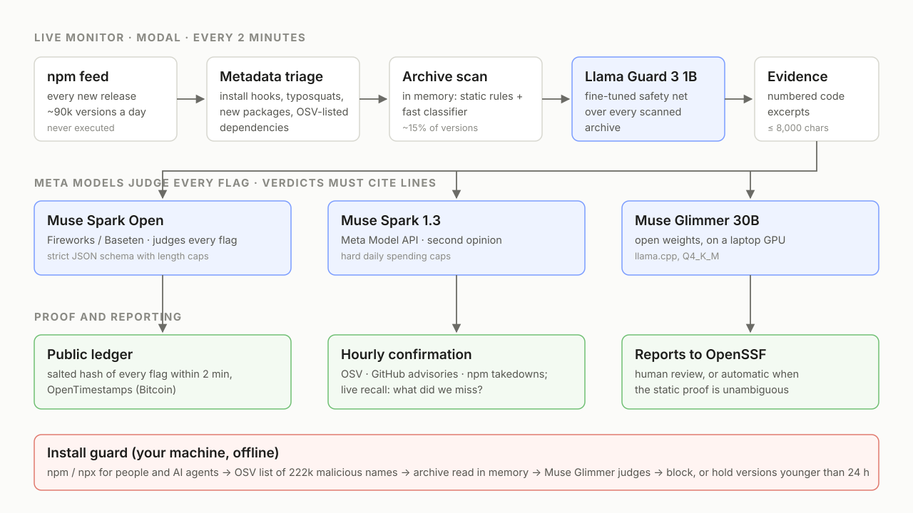
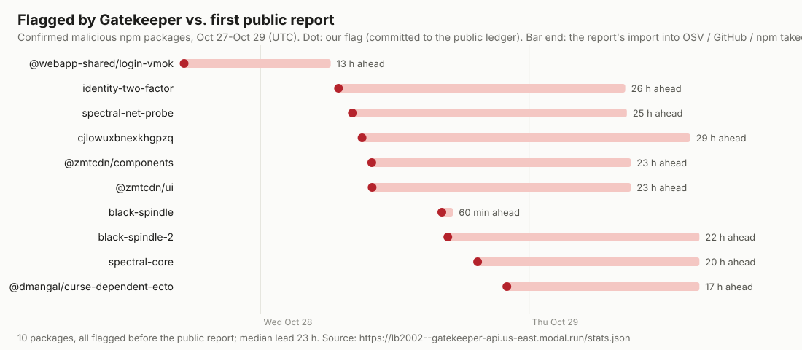

# Gatekeeper

Open-source malware detection for npm, built on Meta's models. It never runs package code.

| Use it | What it does | Try it |
|---|---|---|
| **Investigator** | A Muse agent reads a package like an analyst: picks files, searches, has strings decoded, compares with the previous version or the original of a fork. Code checks its claims. | [**Watch it work on any npm package**](https://lb2002--gatekeeper-api.us-east.modal.run/try), no account |
| **Audit** | Am I already affected? Checks every version in your lockfile, and finds poisoned lockfiles. | [Paste a lockfile](https://lb2002--gatekeeper-api.us-east.modal.run/try), or `gk audit`, or the [GitHub Action](#check-your-project) |
| **Install guard** | Sits in front of `npm install` and `npx`, for you or your AI coding agent, and stops malware before any install script runs. | [Three commands](#try-the-install-guard), under a minute |
| **Live monitor** | Reads every new npm release (~250 changes a minute), has Meta models judge the suspicious ones with cited lines, and reports to OpenSSF. | [Live numbers](https://lb2002--gatekeeper-api.us-east.modal.run/) |

It never runs package code.

**So far (Oct 27-30):** 12 malicious packages flagged that were later confirmed by OSV / GitHub / npm, **every one before the public report, by a median of 21 hours**, about a minute after publication. Of the malware published while the monitor was running, it flagged 58% ([what it missed](#live-results-oct-27-30-2026)). Every flag time is in a public, timestamped ledger.

**The find we are proudest of:** [a campaign that ships no malware at all](#a-package-with-no-malware-in-it). Every scanner passes its packages, because the payload sits in a private dependency nobody can read. Gatekeeper now flags that gap, and following it turned up [8 unreported packages and 5 new private scopes](https://github.com/ossf/malicious-packages/pull/1694), 4 of them published the same day.

The live page updates every 2 minutes and names a detection only once it is independently confirmed. **Public ledger:** https://github.com/lb2002/gatekeeper-ledger

Built for the Meta Global AI Developer Hackathon (Oct 26 - Nov 4, 2026). See [PRIOR_WORK.md](PRIOR_WORK.md) for what we reuse.

**Contents:** [How it works](#how-it-works) · [Investigator](#the-investigator) · [Check your project](#check-your-project) · [Install guard](#install-guard-decisions) · [Proving when we saw something](#proving-when-we-saw-something) · [Live results](#live-results-oct-27-30-2026) · [Evaluation](#evaluation) · [Try the guard](#try-the-install-guard) · [Run it](#run-it)

## How it works



```
npm replication feed (every 2 min, on Modal)
  -> metadata triage (install hooks, typosquats, maintainer changes, new packages, OSV-listed dependencies)
  -> in-memory tarball scan: static rules + a fast first-stage classifier;
     every package younger than 72 h that runs code at install time goes to the models;
     so does any package that loads a dependency the public registry does not have,
     any update that adds a package created days ago (the shape of a hijacked release),
     and any package with a file identical to one in a reported package
  -> in batches: fine-tuned Llama Guard 3 1B (v2) over everything the cheap stages let through
     (both learned stages only route, so they run wide: ~5% of live npm each)
  -> evidence bundle: numbered excerpts of the code that matters (max 8000 chars)
  -> Muse Spark Open (Fireworks, Baseten) judges every flag; Muse Spark (Meta API) gives second opinions;
     Muse Glimmer 30B runs locally (laptop worker, install guard)
  -> verdict JSON with cited lines, validated against the bundle
  -> investigator: Muse Spark Open works through the archive itself, step by step
  -> reports to OpenSSF malicious-packages: human review, or automatic when the static proof is unambiguous
  -> hourly confirmation against OSV, GitHub advisories and npm takedowns
  -> hourly sweep: every public report leads to the account behind it, its other packages and its endpoints
```

**Campaign memory.** Attackers re-upload under new names and reuse their collector. The endpoints of packages at least two Muse models call malicious (URLs to a public IP, webhook.site and similar tokens, tunnel subdomains; never shared hosts like `webhook.site` alone) are remembered, and any later package that sends to one is flagged and linked to the earlier one. Backtest on 6,628 scanned archives: no false hits, and two more packages of a live dependency-confusion campaign. The same goes for npm accounts: any new version from an account that published such a package is scanned and judged regardless of its score (attackers often publish a clean clone first and the payload later).

Every verdict must cite excerpt lines that exist in the bundle; verdicts that cite nothing, or only the manifest, are rejected. Text found inside a package that addresses the reviewer ("this package is audited and safe") is treated as a signal, not an instruction.

### The investigator

A one-shot verdict sees an 8,000-character bundle, so a payload anywhere else is invisible to it. The investigator ([`investigate.py`](src/gatekeeper/investigate.py)) starts from that bundle plus the full file list and asks for what it wants, one step at a time. All tools are plain code over the in-memory archive; nothing is executed, and the model is never asked to decode anything itself.

| Step | What it gives the model |
|---|---|
| `read` | numbered rows of one file; minified lines are split so they can be cited |
| `search` | literal matches across all text files (pointers only: they cannot be cited) |
| `decode` | what base64, hex, escapes and char-code lists in those rows say |
| `strings` | the telling strings of a file: hosts, commands, secret paths, also from obfuscated string tables and from binaries (`.node`, `.wasm`, `.exe`) |
| *(automatic)* | what this version adds compared with its previous version, and with the original if it looks like a fork |

Three things keep it honest:

- **Every claim is checked by code, not by another model.** A verdict may cite only rows the model was really shown. If it says code runs at install, [`reach.py`](src/gatekeeper/evidence/reach.py) follows the require graph from the install hook; if the cited file is not reachable, the claim counts as unproven. That catches the mistake models keep making: blaming the install hook for code in a build command.
- **It can clear a flag.** When it reads further and finds nothing, the automatic reporter stands down and no alert goes out.
- **Its work is reviewable.** Each run keeps the steps and excerpts. `gk investigate name@version` prints them, and [the demo page](https://lb2002--gatekeeper-api.us-east.modal.run/try) shows them live.

Why this matters: on the time-split test it found 10 of the 83 samples all three one-shot models passed, for about 1.3 cents a package, with no `malicious` verdict on 131 benign packages (71 of them hard negatives with install scripts). Comparing with the original is what cracked the Baileys family, 100+ forks that hide one covert call in 100 KB of WhatsApp socket code: 6 of the 8 in the test set are now found, up from 2 by the one-shot models, and the model names the hidden channel subscription.

### A package with no malware in it

The fake job interview campaign ships Tailwind CSS plugins that contain nothing bad: no install script, no network code, no obfuscation. Line 5 of one file requires a private scoped package, and only the victim has the token, committed to the `.npmrc` of the fake take-home assignment. OSV's own automated review of these packages finds nothing. Our models called them benign too.

But the absence is visible. [`phantom.py`](src/gatekeeper/triage/phantom.py) flags any public package whose code or manifest loads a package that does not exist on the public registry, or that npm has replaced with a security holder. With that signal the investigator rates all 6 campaign packages we tested as suspicious, naming the dependency it cannot see.

Following the campaign's fingerprint through npm then found what nobody had reported: **8 new packages and 2 new versions, still live, 4 of the packages published that same day** (one borrows the name of a famous animation library), using **5 private scopes unknown until then**. The attackers had rotated to new scopes after the first reports. Reported as [ossf/malicious-packages#1694](https://github.com/ossf/malicious-packages/pull/1694). The first of them is already confirmed: 90 minutes after our flag, GitHub published an advisory for `tailwindcss-visual-kit` 1.3.7 and npm removed the package.

The install guard applies the same check: a public package that loads something nobody can read is blocked before it reaches your machine.

**Sweep.** Reports are also leads. Every hour, each new OSV report and each package two Muse models agree on is traced to its npm account; the endpoints it names join the campaign memory, the code files of the reported archive become fingerprints (the campaign above shares one `plugin.js` byte for byte across dozens of packages, so a new copy is flagged within two minutes), and the account's other packages are read at once, because campaigns keep clean-looking siblings. Shared publishers (`GitHub Actions` for trusted publishing) are excluded: remembering one flagged 600 automated releases in 25 minutes before we caught it.

### Install guard decisions

```
npm install X  ->  ask the installed npm what it would install or run (its own option parsing, aliases,
                   .npmrc, registries, tags), resolving X with the 24 h waiting period applied
  X comes from git or a URL                                   -> blocked (nothing to check before it runs)
  the project's package-lock.json pins a package outside the registry, or the project's .npmrc sets
    another registry, a proxy or TLS settings (a cloned repo controls both files;
    GK_TRUST_PROJECT_REGISTRY=1 trusts the project's .npmrc)  -> blocked
  X is listed as malicious by OSV (asked live; offline: a local copy of OSV's 222k malicious npm names),
    or a dependency of X is on that list                      -> blocked
  download the tarball, verify sha512, read it in memory
  rules clean AND local classifier clean                      -> clean
  otherwise Muse Glimmer on your machine judges, citing lines
  malicious, or suspicious with confidence >= 0.6, or any error -> blocked, nothing installed
  X requested as an exact version younger than 24 h           -> held, newest older version suggested
    (a tag or range simply resolves to the newest version older than 24 h, and that one is checked)
  run the real npm with --before=<24 h ago>: the whole dependency tree resolves to versions older than
    the waiting period (a hijacked patch release of a dependency is not installed on day one)
```

The waiting period is there because the rest of the ecosystem catches up quickly. Of 742 npm malware reports in OSV for October 2026, measured from the npm publish time of the malicious version to the report's import into OSV, 33% were public within an hour, 58% within a day, 74% within three days (median 10 h). A model catches what is new; the waiting period plus the live OSV lookup catch much of what the model misses. As a rough estimate (assuming the two are independent), the model's ~57% plus a 24 h wait block about 4 in 5 malicious versions, and a 72 h wait (`GK_MIN_AGE_HOURS=72`) about 9 in 10. `GK_MIN_AGE_HOURS=0` turns the wait off, `--gk-allow` overrides one install, and `GK_OFFLINE=1` never contacts OSV (the live lookup sends only the package name and version).

A note on OSV timestamps: an entry's `published` field is set by the reporter and is often backdated to the package's own publish time (301 of the 742 entries above look like that), so it says nothing about when the warning became public. Gatekeeper uses the import time into OSV (or the first commit to OpenSSF malicious-packages) everywhere, including for its own lead times below.

`gk guard update-osv` refreshes the offline list (a 3 MB copy the monitor rebuilds daily; `--from-osv` builds it yourself from OSV's `npm/all.zip`).

The guard does not re-implement npm's command line: it asks the installed npm, through npm's own config loader, command aliases, `npm-package-arg` and `pacote`, which packages a command would install or run and which exact versions (so `npm -p install x`, `npm it x`, `npm create x`, `npx --package=x`, `.npmrc` registries and `--tag` all resolve as npm resolves them). What the guard covers and what it deliberately does not: [docs/guard-threat-model.md](docs/guard-threat-model.md). Decisions are cached per exact tarball integrity. The classifier ships as plain JSON numbers (no pickle), so loading it cannot run code.

### Proving when we saw something

A flag is never named before it is confirmed. Instead, within two minutes, the monitor publishes `sha256(salt || package, version, flag time)` to [gatekeeper-ledger](https://github.com/lb2002/gatekeeper-ledger), one new file per batch, each with an [OpenTimestamps](https://opentimestamps.org) proof anchored in Bitcoin. Once OSV, GitHub or npm independently confirm a detection, its salt is published and anyone can run `gk verify-flag <salt> <line>` and `ots verify` to check that we had it first.

Worked example: `spectral-core@3.0.7` was flagged at 20:30:20 UTC on Oct 28. Its revealed line and salt (in `revealed/2026-10.jsonl`) hash to a digest in `commitments/2026-10-28/203107-67c23a.txt`; `ots upgrade` + `ots verify` on that batch's proof point to Bitcoin block 973597, mined at 20:42:17 UTC that evening (its merkle root `db5b3791…` matches any block explorer). The first public report (OSV import of MAL-2026-18377) came 18.5 hours later.

## Live results (Oct 27-30, 2026)

In its first three days the monitor read 238,117 new npm versions, scanned 38,178 archives and queued 1,717 for the models. **12 packages (29 versions) it flagged have since been independently confirmed as malware** by OSV / OpenSSF malicious-packages, GitHub or npm, **every one of them before any public report: by a median of 21 hours.** Median time from npm publication to our flag: about 1 minute; to the first Muse verdict with cited lines: about 9 minutes more.



| Package (versions) | What it does | Flagged after publish | Ahead of the public report |
|---|---|---|---|
| `@webapp-shared/login-vmok` (5) | dependency confusion: postinstall beacons host data to a raw IP | 1.0-1.6 min | 13 h ([MAL-2026-18356](https://osv.dev/vulnerability/MAL-2026-18356)) |
| `identity-two-factor` | dependency confusion aimed at one company: postinstall POSTs host, user and CI data to webhook.site | 1.8 min | 26 h ([MAL-2026-18367](https://osv.dev/vulnerability/MAL-2026-18367)) |
| `spectral-net-probe` | postinstall calls a Cloudflare quick tunnel | 1.6 min | 25 h ([MAL-2026-18368](https://osv.dev/vulnerability/MAL-2026-18368)) |
| `cjlowuxbnexkhgpzq` | random-name package with an install-time network call (GitHub malware advisory) | 0.1 min | 29 h ([MAL-2026-18381](https://osv.dev/vulnerability/MAL-2026-18381)) |
| `@zmtcdn/components`, `@zmtcdn/ui` | dependency confusion: postinstall POSTs hostname, user, platform and env | 0-2 min | 23 h ([MAL-2026-18372](https://osv.dev/vulnerability/MAL-2026-18372), [-18373](https://osv.dev/vulnerability/MAL-2026-18373)) |
| `black-spindle`, `black-spindle-2` (4) | postinstall runs `curl` against a throwaway host | 0-1.8 min | 1-22 h ([MAL-2026-18359](https://osv.dev/vulnerability/MAL-2026-18359), [-18376](https://osv.dev/vulnerability/MAL-2026-18376)) |
| `spectral-core` (10) | no install script at all: a `binding.gyp` action (run by node-gyp on install) reads process environments and AWS instance metadata and POSTs them to webhook.site; a new version every ~15 min | 0.2-3.3 min | 18-20 h ([MAL-2026-18377](https://osv.dev/vulnerability/MAL-2026-18377)) |
| `@dmangal/curse-dependent-ecto` (3) | the same `binding.gyp` trick: greps the machine for secrets and POSTs every env var | 0.3-1.5 min | 17 h ([MAL-2026-18375](https://osv.dev/vulnerability/MAL-2026-18375)) |
| `claims-acct-unlock` | contacts a domain tied to malicious activity and runs commands (OpenSSF Package Analysis) | 0.8 min | 41 min ([MAL-2026-18404](https://osv.dev/vulnerability/MAL-2026-18404)) |
| `tailwindcss-visual-kit` 1.3.7 | a new version of a reported package, with a new private dependency: found by following the campaign, not on publication | 14.7 h | 1.5 h ([GHSA-f37w-2g4f-58r3](https://github.com/advisories/GHSA-f37w-2g4f-58r3); npm removed it the same minute) |

"Ahead of the public report" uses the report's import time into OSV, not the backdated `published` field (see above). Every flag time is committed to the public ledger before confirmation. Only flags at least one model called malicious or suspicious count; packages that sat in the queue but were judged benign do not, even when OSV listed them later. For two of them (`spectral-core`, `@dmangal/curse-dependent-ecto`) we opened OpenSSF reports ([#1681](https://github.com/ossf/malicious-packages/pull/1681), [#1682](https://github.com/ossf/malicious-packages/pull/1682)) about 15 hours before another scanner's entries for the same packages landed.

**From flags to verdicts.** Of the 1,813 versions the cheap stages sent to the models in the week up to Oct 30, at least one Muse model called 44 malicious and at least two called 33 malicious. 21 of those 33 have since been independently confirmed; most of the other 12 are still on npm and under manual review (on reading the code, some are not malware: a self-run "stealth assistant", and an old package whose build commands post to the author's own Telegram chats, which the models attributed to its install hook; this is why reports go through a human or a strict static check).

**Live recall.** Every hour the monitor takes each new OSV npm malware report and checks it against its own logs. Since it started (Oct 27, 14:02 UTC), OSV reported 19 malicious npm packages whose malware was published while it was watching: **it flagged 11 (58%), all before the report.** Of the 8 misses, OSV's own write-ups for 5 say no harmful behaviour was found (keyword matches in pentest tools and agent CLIs); the other 3 were brand-new packages with a `postinstall` hook whose code did not trip the rules (scores 4-7 of the 9 needed). Since Oct 30, every package younger than 72 hours that runs code at install time goes to a model regardless of its score: about 100-150 versions a day, under $1 a day with Muse Spark Open.

Two traps in measuring this: OSV's `published` date is often backdated (see above), and most of the 81 reports about older malware list npm's own placeholder versions (`0.0.0-stage`, `0.0.1-security`, published by npm when it removes a package). Seeing only those means the malware came out before the monitor started, so they are excluded rather than counted as misses, and the monitor no longer scans them. The monitor was down from about 15:00 to 22:00 UTC on Oct 29 (it stalled on packages with hundreds of new versions; fixed, with alerts since).

### Evaluation

Time-split evaluation: train on samples discovered up to May 2026, test on samples discovered from July 2026 (June left out as a gap; campaign clusters deduplicated, no test cluster in training). Test set: 212 malicious, 590 benign packages including 71 hard negatives with install scripts. Thresholds are fixed on training data before the test set is scored once.

| System | PR-AUC (95% CI) | Recall at 1% FP (test) | False positives on live npm (later days) |
|---|---|---|---|
| Static rules | 0.48 (0.42-0.54) | 18% | - |
| **Muse Glimmer 30B, zero-shot** | **0.88 (0.84-0.91)** | **66%** | as a blocker: 0 of 590 false blocks; explains with cited lines |
| Muse Spark 1.3, zero-shot (Meta API) | 0.87 (0.84-0.91) | 59% | as a blocker: 1 of 590 false blocks |
| Muse Spark Open, zero-shot (Baseten) | 0.88 (0.84-0.91) | 60% | as a blocker: 1 of 590 false blocks |
| TF-IDF + logistic regression (real npm negatives) | 0.87 (0.83-0.90) | 62% | 2.0% |
| Llama Guard 3 1B fine-tuned, v1 (popular packages as negatives) | 0.97 (0.95-0.98) | 87% | **37%**: unusable |
| Llama Guard 3 1B fine-tuned, v2 (real npm negatives) | 0.86 (0.82-0.89) | 61% | 1.2% at threshold 0.3 (0.2% on the monitor's own stream) |

**What changed the system's recall, measured on the same test set:**

| Stage | Result |
|---|---|
| Any one-shot Muse model | 61% of malware (129 of 212), 3 of 590 benign |
| + investigator (Muse Spark Open, up to 8 steps, about 1.3 cents a package) | **66%** (139 of 212); on 131 benign packages no `malicious` verdict and one weak `suspicious` (0.55) |
| First-stage gate, old setting (1-2% of live npm goes on) | reaches 51-60% of the malware |
| First-stage gate, new setting (~5% of live npm each) | reaches 83% |

The gate was never the limit, and neither was money: the models are precise, and most of our credits were unused. So the cheap stages now only route, and the models see several times more.

**What the remaining misses are.** We checked the 83 samples no one-shot model caught against OSV. 18 have no OSV entry at all (mostly prebuilt native binaries). 19 are `@toptal/picasso-*` packages labelled for contacting a domain, with no visible malicious code in the sampled archive. Others are sleeper versions: `vs-modules` 1.2.1 really does ship `// leave blank for now` as its install script; the payload arrives in another version, and the label covers the package. So a share of the test set cannot be found from the archive by anyone, which is why the live numbers matter more than this table.

Live false positives are measured on 1,459 npm releases from days the models never saw (published 2026-10-22, labelled with a week of OSV hindsight, plus the monitor's own sample from 2026-10-28). Most remaining false positives there are SEO spam packages.

**Meta models agree on what they see.** Muse Spark, Muse Spark Open and Muse Glimmer reach the same level (PR-AUC 0.87-0.88) and block 55-57% of the test malware. When Spark and Spark Open both say malicious or suspicious, not one of the 590 benign test packages is blocked; any one of the three catches 60%. The 85 samples all three miss are mostly not a model problem: 78 have no suspicious line in their evidence at all (the payload sits in a dependency, a native binary, or a file over the 1 MB read cap). Gatekeeper therefore also checks every new version's dependencies against the 222k npm names OSV lists as malicious (a clean wrapper that installs known malware is flagged on that alone; 0 hits on 17,768 ordinary npm releases).

**Lesson: cap the free text.** Spark Open first lost 35% of its test answers (and 20% of live verdicts): under strict JSON output it sometimes repeated itself inside the free-text `summary` until the 4,000-token limit. Length caps in the JSON schema (enforced by constrained decoding) fixed it: answers dropped from up to 4,000 to ~250 tokens, and PR-AUC rose from 0.78 to 0.88.

**Lesson: test on real traffic.** Llama Guard v1 looked excellent offline but flagged 37% of live npm releases. Its benign training data were popular, well-maintained packages, so it learned "unpolished = malicious", and the offline test shared that bias. Retrained with real npm releases as negatives (v2), it is usable as a safety net, and the honest ranking changes: zero-shot Muse Glimmer is the strongest detector, and the small models serve as fast pre-filters in front of it. The thresholds of the small models are fixed on training data; the monitor's Llama Guard threshold (0.3, stricter than validation) was chosen after looking at the 2026-10-22 slice, so the monitor's own stream is the cleaner check. Fine-tuned models were trained only on ground truth (never on Muse Spark outputs).

## Safety

Gatekeeper never executes package code. Package archives are read in memory; malware samples are only unpacked inside isolated cloud containers. This repository contains no malware: only package identifiers and scripts to rebuild datasets. The demo package in `demo/villain-pkg` is a harmless imitation that only talks to localhost.

## Try the investigator

Open [the demo](https://lb2002--gatekeeper-api.us-east.modal.run/try), type any npm package, and watch the steps come in. No account. With a Modal login, `uv run gk investigate name@version` does the same in a terminal.

Open weights: the investigator and every-flag verdicts run on **Muse Spark Open** through partner inference (Baseten, Fireworks); **Muse Glimmer 30B** runs on a laptop GPU through llama.cpp; the fine-tuned **Llama Guard 3 1B** runs on a Modal GPU. Muse Spark (Meta Model API) gives second opinions.

## Check your project

`gk audit` answers the question after every incident: am I already affected? It reads the lockfile (`package-lock.json`, `pnpm-lock.yaml`, `yarn.lock`) and nothing else, so nothing is installed or run.

```bash
gk guard setup      # once: downloads the list of known malware
gk audit            # in your project; --offline sends nothing, --json for scripts
```

The same check runs [on the demo page](https://lb2002--gatekeeper-api.us-east.modal.run/try) without installing anything. It flags versions OSV lists as malware, npm's placeholders for removed packages, and locked packages that come from a server other than the registry (a poisoned lockfile); code hosts like GitHub are shown as a note. Tested on the lockfiles of Next.js, VS Code, React and Babel (9,000 packages): no false alarms. Exit code 1 means something needs a look, so it also works in CI:

```yaml
- uses: lb2002/gatekeeper@v1
```

## Try the install guard

Needs [uv](https://docs.astral.sh/uv/) and Node/npm. No account or API key, under a minute:

```bash
uv tool install git+https://github.com/lb2002/gatekeeper
gk guard setup                # shims, list of 222k malicious npm names (3 MB), local classifier (6 MB)
gk guard shell                # Windows: a PowerShell with the shims first on PATH
# macOS/Linux instead: export PATH="$HOME/.gatekeeper/bin:$PATH"
npm install <package>         # checked before anything is installed
```

Known-malicious packages and dependencies are blocked and brand-new versions are held without any model. Archives the static rules flag go to Muse Glimmer through a local [llama.cpp](https://github.com/ggml-org/llama.cpp) server (`llama-server -m Muse-Glimmer-30B-KQuant-17GB-Q4_K_M.gguf --jinja -fa on -c 8192 --port 8080 --reasoning-format deepseek --reasoning-budget 48 --alias muse-glimmer`, the [official GGUF](https://huggingface.co/meta-models/Muse-Glimmer-30B-GGUF); `GK_LOCAL_URL` points elsewhere). Without it those installs fail closed (blocked, `--gk-allow` to override). `demo/` has a harmless typosquat and a local registry to see a block end to end.

## Run it

```bash
uv sync
uv run pytest
uv run gk watch                                          # live view of new npm releases (metadata only)
uv run gk check <package>@<version> --backend local      # needs llama-server with Muse Glimmer
uv run gk guard enable                                   # npm/npx shims
uv run gk guard update-osv                               # offline list of 222k malicious npm names
uv run modal deploy modal_app/app.py                     # the live monitor
```
